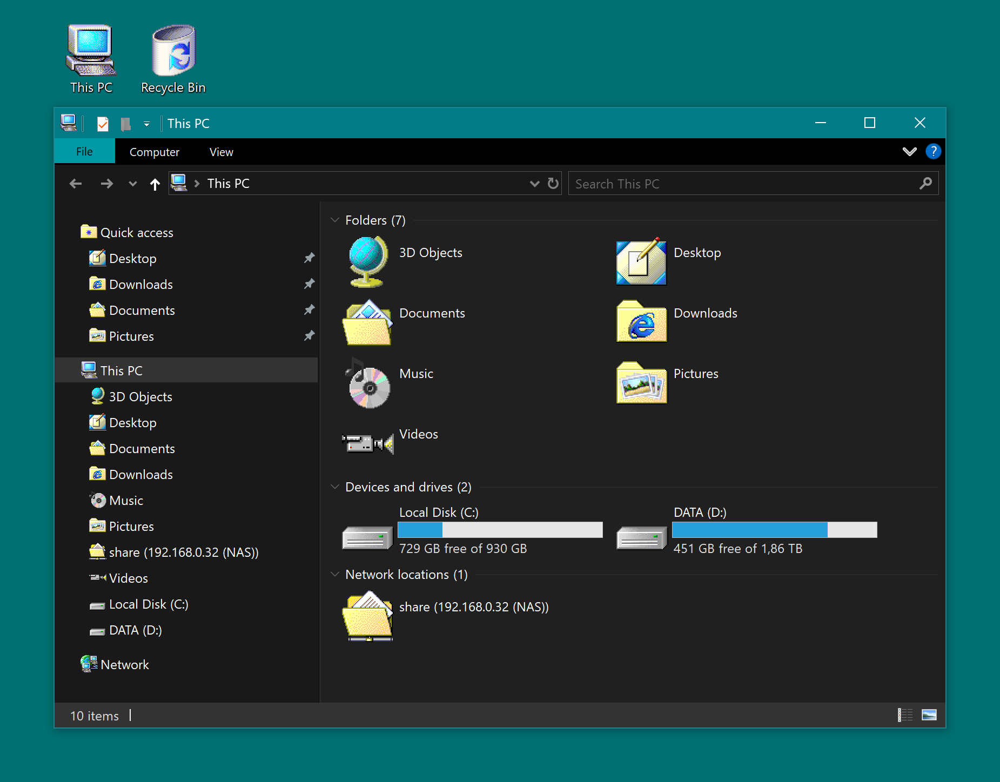

# win2000-icons

Windows 2000 icons for Windows :)

Larger icons are made with integer scaling (they stay sharp on high DPI displays).

## Usage

- Download or clone the repo, run `apply.cmd` (accept the UAC prompt).
- To restore the default icons, run `restore.cmd`.
- The icons are automatically copied to `C:\ProgramData\win2000-icons` so the repo can be deleted afterwards.

Tested on Windows 10.

## What it changes

The scripts don't modify any system files, and everything can be undone with `restore.cmd`.

- folders, drives, network shares, unknown files and the shortcut arrow
- This PC, Recycle Bin, Network, Control Panel, Quick access and the user folders
- `.zip` files and the File Explorer shortcut
- thumbnails are turned off, because Windows has no option to disable folder content previews on their own

## Legal

The icons come from Windows 2000 and Windows Me and are the property of Microsoft. This is a non-commercial fan project, and the Unlicense covers only the scripts. If you represent MS and want it taken down, open an issue and I will remove it.
